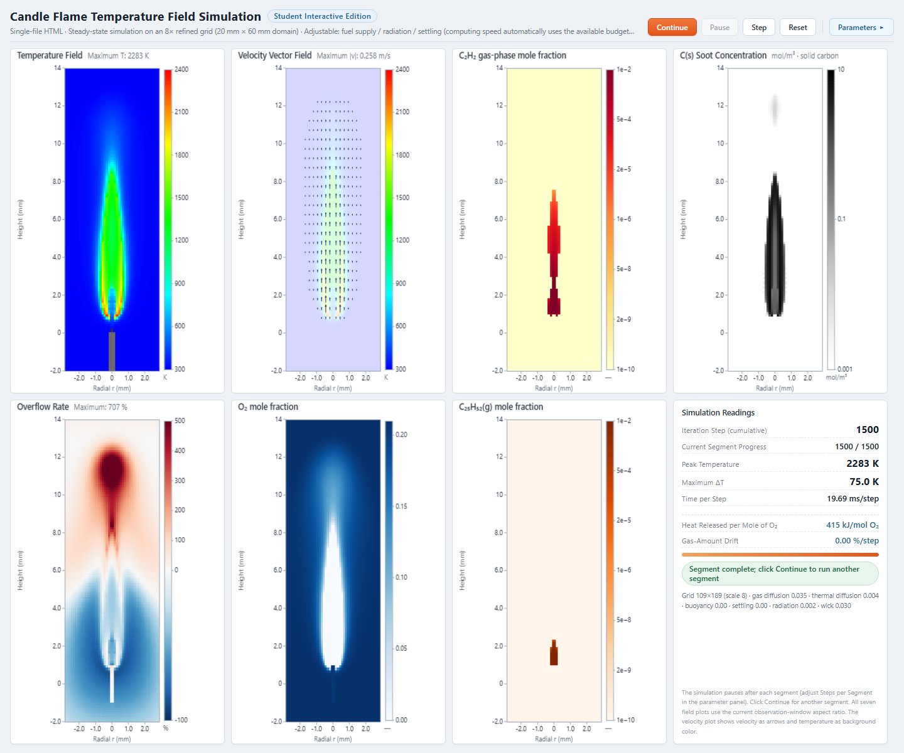

# Candle-Flame Temperature-Field Simulation for Teaching

**Axisymmetric candle-flame temperature-field simulation · English edition**

[中文](README.zh-CN.md) · [Project portal](index.html) · [GitHub](https://github.com/neo805/candle-flame-lab)

A set of modeling and programming materials built around an **axisymmetric candle-flame temperature field**. Students inspect temperature, species, and flow-related fields in a browser while completing JavaScript code that actually runs in the simulation, connecting reaction stoichiometry, grid exchange, and time advancement with observable model behavior.

The original teaching activity and Chinese materials are complete. This repository provides complete Chinese and English editions for publication, reuse, and focused revision.

## Open directly in a browser

- No runtime, package installation, build step, or local server is required.
- A recent version of **Chrome** or **Edge** is recommended. Download the complete repository and open the root [`index.html`](index.html), or open any document below directly.
- Once GitHub Pages is enabled, the project portal will also be available at <https://neo805.github.io/candle-flame-lab/>.

## English materials

| File | Purpose |
| --- | --- |
| [Student simulation](en/candle-simulation-student.html) | Browser-based interactive simulation with intentional classroom code placeholders. |
| [Simulation reference](en/candle-simulation-reference.html) | Completed interactive version for checking work and classroom demonstration. |
| [Classroom tasks](en/classroom-tasks.html) | Three executable code-completion tasks. |
| [Classroom tasks reference](en/classroom-tasks-reference.html) | Reference implementations for all three tasks. |
| [Mathematical and chemical methods](en/candle-simulation-math.html) | Nine species, six reactions, transport, energy, wick, soot, and current parameters; statically typeset with embedded KaTeX fonts for offline reading. |

A suggested sequence is to observe the interactive simulation first, then modify the model through the classroom tasks, and consult the reference editions after an independent attempt.

## The three classroom tasks

1. **Six reactions: stoichiometry and enthalpy changes** 
   Complete R2–R6 by specifying species consumption and production, together with the signs and magnitudes of heat release and heat absorption.
2. **Adjacent cells: normalized weights in four directions** 
   Construct neighboring-cell exchange weights from cell-face geometry, buoyancy, and flow contributions, then normalize the four directional fractions.
3. **Main simulation loop: advancing the solution** 
   Complete the temperature-diffusion and cell-reaction calls, the loop condition, and the increment to understand the order of operations during each step.

## Teaching scope and model limitations

> **This is a simplified teaching model for explaining model structure and numerical processes. It is not intended for quantitative research, engineering design, or safety prediction.**

The displayed “overflow rate” is `100 × (nRT / (P_atm V_cell) − 1)`: an **equivalent-volume deviation referenced to 1 atm**, or a relative pressure deviation in a fixed-volume cell. The current model has no isobaric constraint or pressure projection. It is a diagnostic of discrete-model behavior, not a measurement of mass leakage from a real flame.

For the derivation and optional improvement routes, see [Model notes](docs/MODEL_NOTES.en.md).

The soot panel shows the **molar concentration of solid carbon** (mol/m³) on a `1e-3…10 mol/m³` logarithmic scale. Key limitations also include the fixed-volume Eulerian mesh, axisymmetric assumption, simplified six-reaction chemistry and transport, simplified radiation, simplified velocity field, and finite resolution of the non-uniform mesh.

The materials are appropriate for comparing trends, checking code, and learning discrete modeling. They are not appropriate for fire-safety assessment, equipment design, exposure-risk evaluation, or predictions of real incidents.

## License

This project is released under the [MIT License](LICENSE). Copyright © 2026 neo805. Use, modification, and distribution are permitted subject to preservation of the license and copyright notice.

---

Maintainer note: the published tree contains only ready-to-open documents, bilingual READMEs, the portal, and the necessary image. The local `_dev/` build workspace is intentionally excluded from the release tree.
