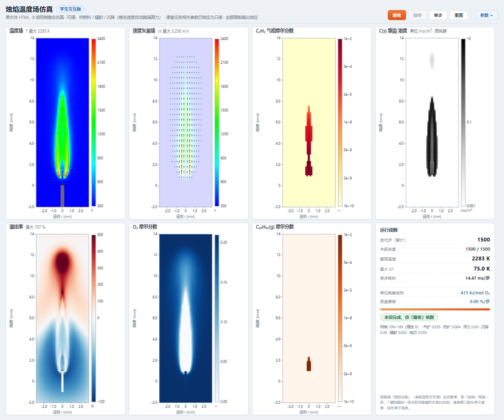

# Candle-Flame Lab

**Axisymmetric candle-flame temperature-field simulation for teaching**

[中文说明](README.zh-CN.md) · [English README](README.en.md) · [Project portal](index.html)



A bilingual, browser-based teaching package for numerical modeling:

- observe temperature, species, and flow fields;
- complete JavaScript that participates in the live simulation;
- compare the student, reference, and documentation editions.

No installation, build step, or local server is required.

## Repository map

```
.
├── README.md                 language selector (this file)
├── README.zh-CN.md           full Chinese README
├── README.en.md              full English README
├── LICENSE
├── index.html                bilingual project portal
├── zh/                       Chinese editions (5 HTML files)
├── en/                       English editions (5 HTML files)
└── docs/
    ├── MODEL_NOTES.zh-CN.md
    ├── MODEL_NOTES.en.md
    └── images/
        ├── candle-simulation.png
        └── candle-simulation-en.png
```

## License

[MIT](LICENSE) © 2026 neo805. This is a simplified teaching model, not a predictive safety tool.
