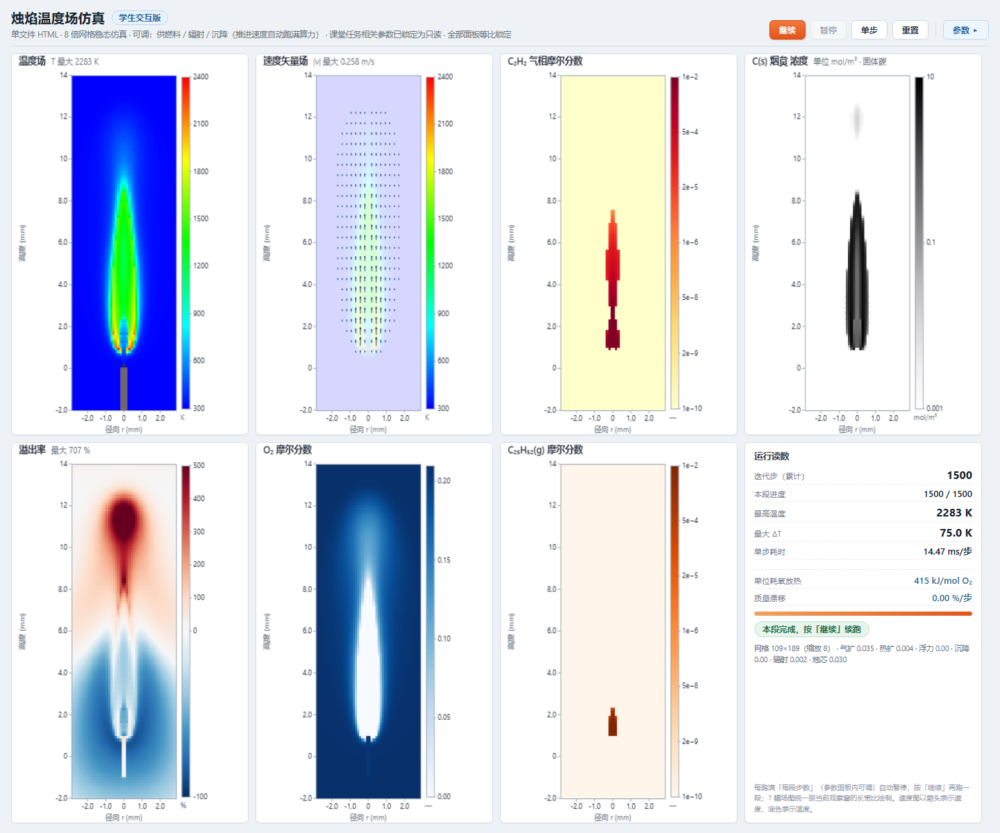

# 烛焰温度场仿真建模教学设计

**轴对称烛焰温度场教学仿真 · 中文版**

[English](README.en.md) · [项目入口](index.html) · [GitHub](https://github.com/neo805/candle-flame-lab)

一套围绕**轴对称烛焰温度场**展开的建模与编程教学材料。学生在浏览器中观察温度、组分和流动等场量，并直接补全真正参与计算的 JavaScript 代码，把反应计量、网格交换和时间推进与仿真现象联系起来。

原教学活动与中文材料已完成。本仓库提供完整的中英文材料，用于发布、复用和持续修订。

## 直接使用

- 无需安装运行时、依赖包或构建工具，也不需要启动本地服务器。
- 建议使用较新的 **Chrome** 或 **Edge**。下载完整仓库后，直接用浏览器打开根目录的 [`index.html`](index.html)。
- 启用 GitHub Pages 后，也可通过 <https://neo805.github.io/candle-flame-lab/> 使用项目入口。

## 中文材料

| 文件 | 用途 |
| --- | --- |
| [烛焰仿真 · 学生交互版](zh/candle-simulation-student.html) | 含有意保留的课堂代码占位；完整燃烧演示请使用参考答案版。 |
| [烛焰仿真 · 学生交互版参考答案](zh/candle-simulation-reference.html) | 已完成课堂代码的交互仿真，供核对与教师演示。 |
| [课堂任务](zh/classroom-tasks.html) | 补全三段会实际写入并运行的仿真代码。 |
| [课堂任务 · 参考答案](zh/classroom-tasks-reference.html) | 三项任务的参考实现与核对材料。 |
| [数学与化学算法说明](zh/candle-simulation-math.html) | 九个组分、六个反应、输运/能量/灯芯/烟炱公式与当前参数总表；KaTeX 静态排版，字体内嵌，离线可读。 |

建议从“学生交互版”观察现象，再进入“课堂任务”修改模型；参考答案适合在完成尝试后使用。

## 三项课堂任务

1. **六反应：计量数与焓变** 
   按示例补全 R2–R6，明确各组分的消耗与生成，以及放热、蒸发热解等吸热过程的符号和数量级。
2. **邻接网格：四方向归一化权重** 
   由网格面积、浮力与气流份量构造邻接交换权重，并归一化四个方向的比例。
3. **仿真主循环：逐步推进** 
   补全温度扩散、网格化学反应及循环条件和步进，理解每一步的执行顺序。

## 教学定位与模型边界

> **这是用于解释建模结构和数值过程的教学简化模型，不用于定量科研、工程设计或安全预测。**

界面中的“溢出率”定义为 `100 × (nRT / (P_atm V_cell) − 1)`，可理解为**换算到 1 atm 的等效体积偏差**，也可理解为固定体积下的相对压力偏差；当前模型没有等压约束或压力投影。它用于观察离散模型的数值行为，不是对真实火焰质量泄漏的测量。

详细机理分析与可选改进路线见 [模型说明](docs/MODEL_NOTES.zh-CN.md)。

烟炱面板显示每个网格内固体碳的**摩尔浓度**（mol/m³），色标为 `1e-3…10 mol/m³`。主要限制还包括：固定体积 Euler 网格、轴对称假设、简化六反应与输运、简化辐射、简化速度场，以及非均匀网格的有限分辨率。

因此，材料适合用于比较趋势、检查代码和理解离散建模，不适合消防评估、设备设计、暴露风险判断或真实事故预测。

## 许可

本项目采用 [MIT License](LICENSE)。版权所有 © 2026 neo805。在保留许可与版权声明的前提下，可使用、修改和分发。

---

维护说明：仓库发布树只包含可直接打开的文档、双语 README、入口页与必要图片；本地的 `_dev/` 构建工作区不随发布树分享。
